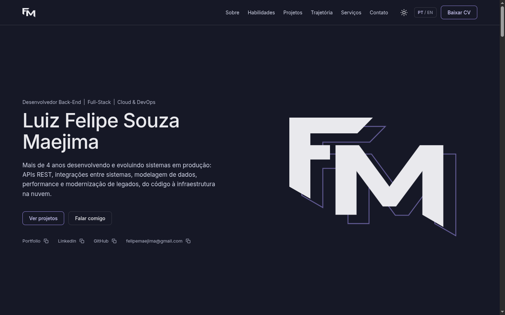
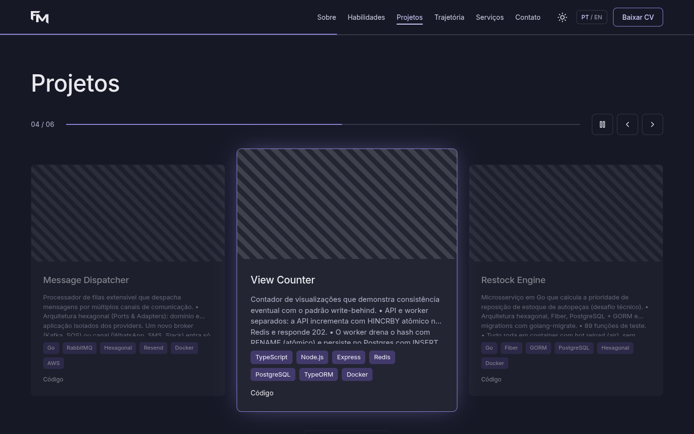
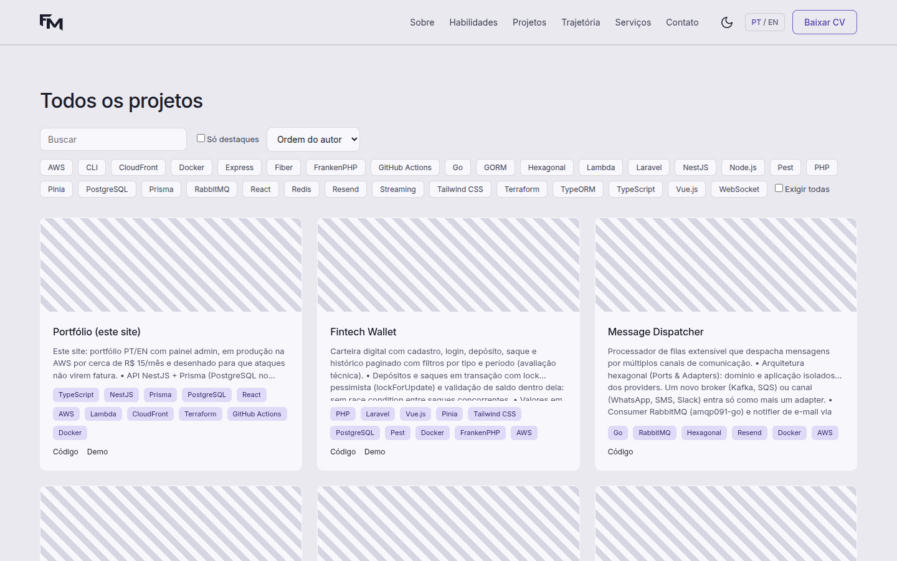
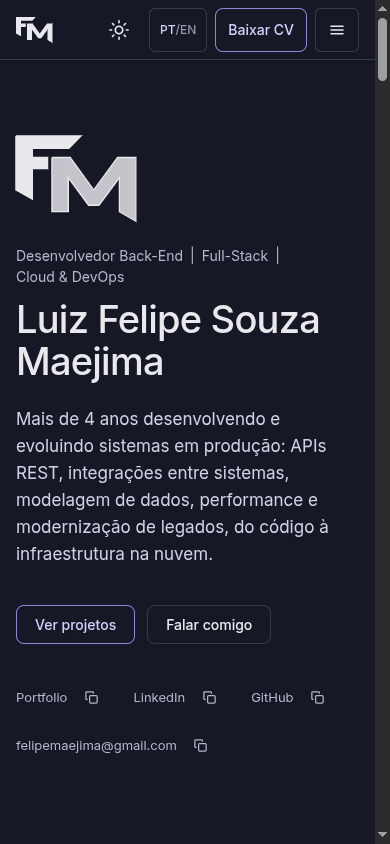
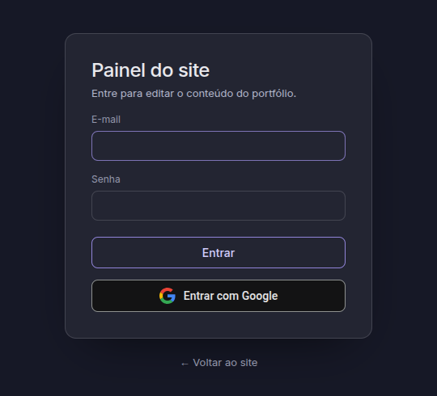
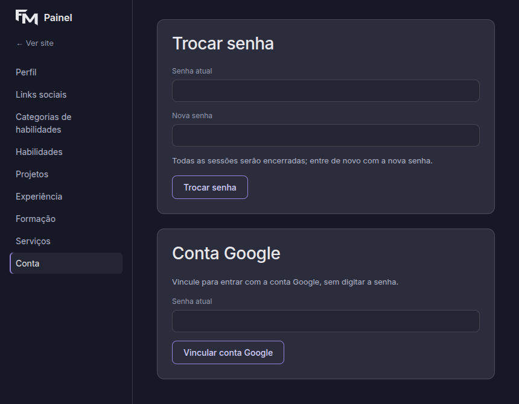
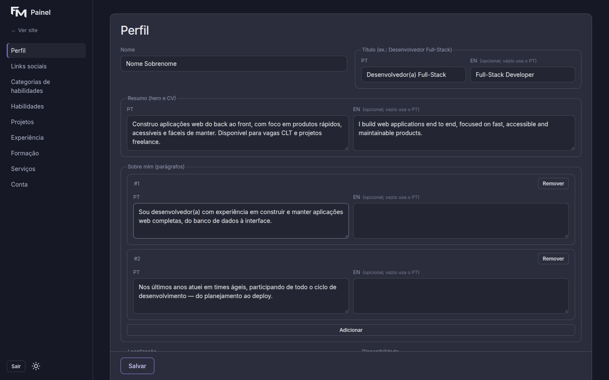
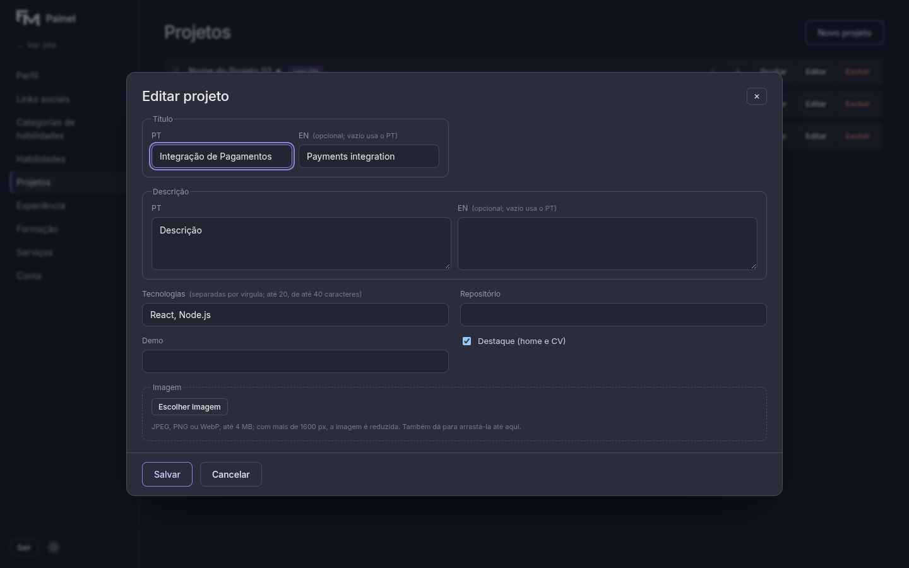

# Portfolio

Meu site pessoal, com painel administrativo próprio, e também um projeto de portfólio: um sistema pequeno, feito como
se fosse um produto de verdade, em produção na AWS e pensado para que ataques não virem fatura.

Todo o conteúdo (perfil, projetos, experiência, formação, habilidades, serviços, links) vem de uma API e é editado no
painel, em português e inglês. O CV em PDF sai dos mesmos dados, então nunca fica desatualizado.

**Em produção:** [felipemaejima.com](https://felipemaejima.com) (site), `/admin` (painel) e `/api` (API).



## Estado atual

Em produção e em uso. Tudo o que está descrito abaixo funciona em `felipemaejima.com`. Cada mudança passa por lint e
testes no CI antes do deploy, e a API ainda passa por um smoke test logo depois.

Próximos passos, nas [issues](https://github.com/felipemaejima/portfolio-2/issues):
- rota do painel não estática;
- Alertas mais informativos no Discord;
- módulo de agendamento.

## Funcionalidades

### Site público

| | |
|---|---|
|  |  |



- **Página inicial** com todo o conteúdo numa única requisição (`GET /api/portfolio`): apresentação, sobre, habilidades,
  carrossel dos **projetos em destaque**, trajetória (experiência e formação), serviços e contato.
- **PT/EN.** O que não tiver tradução em inglês cai para o português.
- **Tema claro e escuro**, layout responsivo e menu em gaveta no celular.
- **Página de projetos** com filtro por tags (qualquer uma ou todas), busca por texto sem acentos, "só destaques",
  ordenação e paginação.
- **CV em PDF** gerado sob demanda, no idioma escolhido, com cache por ETag.
- **Formulário de contato** que entrega a mensagem no canal `#contato` do meu Discord. Tem honeypot contra bots, limite
  de tamanho e rate limit. Se o Discord falha, o site mostra erro, nunca um sucesso falso.
- **Avisos de Visita** no canal `#visitas`, com página, idioma, origem e navegador. Cada pessoa conta no máximo uma vez
  por dia (por navegador e por IP), e há um teto de 50 avisos por dia. O IP do visitante nunca sai da API (LGPD), e o
  navegador do admin nunca conta.

<br clear="right">

### Painel admin (`/admin`)

| | |
|---|---|
|  |  |
|  |  |

<sub>Painel no ambiente local, com dados de exemplo.</sub>

- **Login com e-mail e senha ou com o Google.** O Google só serve para quem já vinculou a conta: não existe cadastro, e
  o único admin é criado por seed. O fluxo é OpenID Connect no servidor (Authorization Code + PKCE + `nonce`, `state`
  num cookie cifrado de uso único, nenhum token do Google guardado). Detalhes no [ADR 0002](docs/adr/0002-login-google-fluxo-de-servidor.md).
- **Página Conta:** trocar a senha e vincular ou desvincular a conta Google. Vincular pede a senha atual. Trocar a senha
  e desvincular encerram todas as sessões.
- **Aviso de cada Login, vínculo e desvínculo** no canal `#alertas`, com método, IP e navegador: um Login que não fui eu
  é um incidente, e o procedimento está documentado.
- **CRUD de todas as seções**, com campos `{pt, en}` lado a lado e um selo "sem EN" no que falta traduzir. Tem também
  reordenação (arrastar ou setas, gravada de forma atômica), itens ocultos (rascunho) e projetos em destaque.
- **Upload de imagens** validado pelo conteúdo real do arquivo (magic bytes), até 4 MB. Imagens grandes são reduzidas e
  convertidas para WebP no navegador. Mídia ainda em uso não pode ser apagada.
- **Proteção contra perda de alterações:** sair de um formulário modificado pede confirmação.

### Operação

- **Alertas** no e-mail e no canal `#alertas`:
  - erros da API (logs de nível `error` e falhas da Lambda);
  - taxa de 5xx no CloudFront;
  - uso fora do normal;
  - Budget e anomalia de custo;
  - recurso exposto publicamente (Access Analyzer).

  Uma Lambda própria formata cada Alerta para o Discord.
- **Disjuntor de custo:** se o uso da API dispara ou o Budget estoura, a API é desligada sozinha (concorrência zero) até
  eu religar com `make api-enable`.
- **Backup diário** do banco para o S3 e **smoke test** de produção a cada deploy da API (`make smoke` roda o mesmo à
  mão).

## Destaques de engenharia

O que este repositório mostra além das telas:

- **Custo previsível:** orçamento de ~R$ 60/mês, arquitetura serverless com custo perto de zero quando parada, e borda
  (CloudFront no plano fixo + WAF) que não cobra por requisição bloqueada.
- **Segurança em camadas:**
  - deny-by-default na API;
  - Lambda que só o CloudFront consegue chamar;
  - segredos só no SSM, lidos no boot;
  - CI sem chaves AWS (OIDC);
  - avisos de Login para detectar intrusão.
- **Infraestrutura como código:** tudo no Terraform, rodando em container, com acesso humano por SSO e credenciais
  temporárias.
- **Testes que exercitam o sistema de verdade:**
  - API testada por HTTP contra um Postgres real; só o Google e o Discord são dublês;
  - front testado como o usuário o usa (Testing Library).
- **Decisões documentadas:**
  - [specs](docs/specs/) com user stories e decisões;
  - [ADRs](docs/adr/);
  - [glossário](GLOSSARY.md) do domínio (Visita, Login, Conta vinculada, Alerta…), usado igual no código, nos testes e
    na interface.

## Stack

| Camada | Tecnologia |
|---|---|
| Monorepo | pnpm 12 workspaces, Node 24 |
| API (`apps/api`) | NestJS 12, Prisma 7 (`@prisma/adapter-pg`), PostgreSQL 18, zod, argon2id, JWT, openid-client, pdfmake, Swagger/OpenAPI |
| Web (`apps/web`) | React 19, Vite 8, React Router (SPA; o admin é carregado sob demanda) |
| Qualidade | TypeScript 6, oxlint (type-aware), Jest 30 (e2e contra Postgres real), Vitest + Testing Library |
| Ambiente local | Docker Compose + Makefile. Não precisa de Node, pnpm nem Postgres instalados |
| Nuvem | AWS (CloudFront, WAF, Lambda, S3, ECR, Route 53, SSM, SNS, CloudWatch…), Neon (Postgres serverless), Terraform |
| Avisos | Discord (webhooks: `#contato`, `#visitas`, `#alertas`) |
| CI/CD | GitHub Actions com OIDC (sem chaves AWS guardadas no GitHub) |

## Rodando localmente

Requisitos: Docker e `make`.

```sh
cp .env.example .env   # valores de dev; nunca reutilize fora da sua máquina
make up                # postgres, api (hot reload) e web
make migrate           # aplica as migrations
make seed              # cria o admin com ADMIN_EMAIL / ADMIN_PASSWORD do .env
```

- Site: http://localhost:5173 (admin em `/admin`)
- API: http://localhost:3000/api (Swagger em `/api/docs`, só fora de produção)
- Sem os webhooks do Discord no `.env`, contato, Visitas e avisos só vão para o log.
- Sem as credenciais do Google, o botão "Entrar com Google" leva a um erro genérico. Para testar o Google, crie um
  cliente OAuth de dev (veja o `.env.example`).

Comandos do dia a dia (`make help` lista todos):

| Comando | O que faz |
|---|---|
| `make test` | testes da API (e2e) contra um Postgres descartável (`t=<padrão>` filtra) |
| `make test-web` | testes do front |
| `make lint` | typecheck + oxlint (api e web) |
| `make migration name=x` | cria uma migration a partir do schema |
| `make openapi` | exporta `apps/api/openapi.json` |
| `make studio` | Prisma Studio |
| `make reset-db` | recria o banco de dev |

## Arquitetura

```
                        felipemaejima.com (Route 53 + ACM)
                                      │
                   CloudFront (plano fixo Free) + WAF
               ┌──────────────────────┼───────────────────────┐
               │ /*                   │ /uploads/*            │ /api/*
         S3 (site React)        S3 (imagens)         Lambda Function URL (IAM, só via OAC)
                                                              │
                                              Lambda arm64: imagem Docker do Nest
                                               (Lambda Web Adapter), segredos do SSM
                                                    │                    │
                                       Neon Postgres (pooled)     Discord (webhooks)
```

**Por que assim.** O orçamento é de ~R$ 60/mês, e ataques não podem virar fatura.
- **Uma distribuição CloudFront** serve site, imagens e API no mesmo domínio: sem CORS e com um único ponto de defesa.
  Ela fica no **plano de preço fixo Free**, que não cobra excedente e não conta requisições bloqueadas.
- **WAF** com reputação de IP, rate limit por IP e regras gerenciadas da AWS.
- **API no Lambda** (e não ECS/EC2/RDS): custo ~zero parado. A **Function URL exige assinatura IAM**, e só o
  CloudFront (via OAC) assina. Quem tentar chamar a Lambda direto é recusado antes de a função rodar.
  - Por causa do OAC, requisições com corpo enviam `x-amz-content-sha256` (hash do corpo), e o token vai em
    `X-Authorization`, já que `Authorization` é usado pela assinatura.
- **Mesma imagem Docker** local e na Lambda, via Lambda Web Adapter. O Nest roda como um servidor Express comum.
- **Banco no Neon** (fora da AWS, plano gratuito), o que dispensa VPC e RDS.
- **Disjuntor de custo**: um alarme de uso da API ou o Budget estourado disparam SNS → uma Lambda que zera a
  concorrência da API. `make api-enable` religa.
- **Segredos** ficam no SSM Parameter Store como SecureString e são lidos pela API no boot: URL do banco, chaves JWT,
  webhooks do Discord, client secret do Google e chave do cookie do Login pelo Google. Não ficam em variáveis de
  ambiente, nem no Terraform, nem no GitHub.

Detalhes e trade-offs: [ADR 0001](docs/adr/0001-api-em-lambda.md) e [spec de infra](docs/specs/infra.md).

### Segurança da API (resumo)
- Negação por padrão: toda rota exige JWT, exceto as marcadas como públicas.
- Access token curto no header + refresh token rotativo em cookie `httpOnly`, `Secure`, `SameSite=Strict`, restrito a
  `/api/auth/refresh`. Logout, troca de senha e desvínculo da conta Google revogam todas as sessões (`tokenVersion`).
- Senhas com argon2id. Login com erro genérico e rate limit (contadores no Postgres, IP vindo de um header gravado
  pela borda, que o cliente não consegue forjar).
- Login pelo Google só para uma Conta vinculada antes, de dentro do painel e com a senha atual. Nunca por e-mail igual.
- Payloads validados (campos desconhecidos são recusados), `Cache-Control: no-store` por padrão e CSP no front.

## AWS e Terraform

Toda a infraestrutura é código em [`infra/`](infra/), aplicada pelo Terraform rodando em container (`make tf-*`):
- `infra/bootstrap`: o bucket S3 que guarda o *state* do Terraform (versionado, com lock nativo).
- `infra/main`: todo o resto (DNS, certificado, CloudFront, WAF, S3, ECR, Lambda, SSM, alarmes, Budget, CloudTrail,
  Access Analyzer, repassador de Alertas, backups e as roles do GitHub).

Acesso humano pelo **IAM Identity Center (SSO)**, com credenciais temporárias (`make aws-login`). Não existem access
keys de longa duração.

Alguns passos ficam fora do Terraform de propósito:
- Os valores secretos são digitados, sem eco, e nunca aparecem em state nem em plano: banco (`make db-secrets`),
  webhooks do Discord (`make discord-secrets`) e client secret do Google (`make google-secrets`).
- A assinatura do plano do CloudFront (`make plan-subscribe`) ainda não tem recurso no provider.

Passo a passo da primeira implantação, operação e restauração de backup: [`infra/README.md`](infra/README.md).

## CI/CD

| Workflow | Quando | O que faz |
|---|---|---|
| `api.yml` | push em qualquer branch em `apps/api` | lint + e2e; **só na `main`**, e só se passarem: imagem arm64 no ECR → migrations no Neon → atualiza a Lambda → smoke |
| `web.yml` | push em qualquer branch em `apps/web` | lint + testes → build; **só na `main`**: S3 → invalida o CloudFront |
| `backup.yml` | diário | `pg_dump` do Neon para um bucket S3 |

O GitHub obtém credenciais temporárias por **OIDC**. Cada role confia só neste repositório (IDs imutáveis) e no
environment `production`, com permissões mínimas: a de deploy da API, por exemplo, não lê os segredos da aplicação.
As actions são fixadas por SHA.

## Desenvolvimento com IA

O projeto foi desenvolvido com o **Claude Code** (Anthropic) como par de programação. Eu defino o que construir,
reviso e decido. A IA investiga, propõe e implementa.

1. **Especificação antes do código.** Cada frente começou com uma sessão de perguntas, em que a IA questiona
   requisitos, casos de borda e trade-offs até não sobrar ambiguidade. O resultado vira uma spec versionada, que é o
   contrato da implementação: [backend](docs/specs/backend.md) e [infra](docs/specs/infra.md). Decisões
   arquiteturais viram ADR, e os termos do domínio vão para o [glossário](GLOSSARY.md).
2. **Tickets pequenos.** A spec é quebrada em issues no GitHub, cada uma com critérios de aceite, e cada issue vira
   um PR.
3. **Implementação com TDD**, guiada pela spec, com regras explícitas:
   - simples e modular;
   - sem abstrações especulativas nem testes inflados;
   - versões mais recentes compatíveis.
4. **Revisão em duas frentes antes do PR.** Uma confere os padrões do repositório, a outra confere se o código faz o
   que o ticket pediu. Depois vem a minha revisão de tudo: a IA não faz commit nem merge sem pedido.
5. **Nada sensível é executado pela IA.** Ela não lê segredos nem roda `terraform apply`, deploys ou qualquer mudança
   em produção. Entrega o comando pronto e explica o efeito, e eu executo e compartilho só a saída não sensível.
6. **Validação contra fontes oficiais.** Decisões de segurança e comandos AWS são conferidos na documentação oficial
   antes de aplicar. Erros reais de deploy foram diagnosticados a partir da saída, sem suposições.

A IA acelera a pesquisa e a escrita. As decisões, a revisão e a responsabilidade pelo que vai para produção são
humanas.

## Estrutura

```
apps/api      API NestJS (módulos por seção do portfolio, auth + Google, mídia, CV, contato, Visitas, storage local/S3)
apps/web      site público + admin (React)
infra/        Terraform (bootstrap + main), Lambdas de Alertas e do disjuntor, guia de operação
docs/specs    specs de backend e infra
docs/adr      decisões de arquitetura
docs/images   capturas de tela deste README
GLOSSARY.md   linguagem do domínio
.github/      workflows de CI/CD
```
